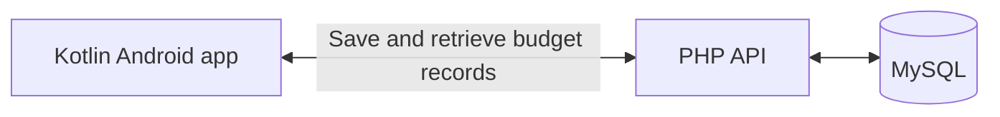

# SpendAnchor

**Android budgeting app · Kotlin · PHP · MySQL**

SpendAnchor helps people allocate income to commitments, savings, and everyday spending. Users can define their own expenses, then review what their plan leaves available to spend.

## My contribution

I designed and built the native Android app and its PHP API, set up MySQL storage, and took the app through testing and release. I organised the mobile workflow around creating a plan, entering income and expenses, and reviewing the resulting summary.

## Architecture

## Product preview

The product page walks through wallets, commitments, activity, and savings, and provides the Android download. [Explore SpendAnchor](https://spendanchor.tafadzwamaresi.co.zw/)
