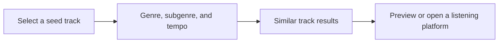

# TrackSeed

**Music discovery web app · API integration · Responsive interface**

TrackSeed helps listeners find songs similar to one they already like. The discovery flow starts with a selected track and uses characteristics such as genre, subgenre, and tempo to surface recommendations.

## My contribution

I designed and developed the web app, integrated music data, and deployed the product. I designed the results for mobile screens, with the track title, artist, optional preview, and links to supported listening platforms.

## Discovery flow

## Product preview

[See the published project write-up](https://tafadzwamaresi.co.zw/project/trackseed)
